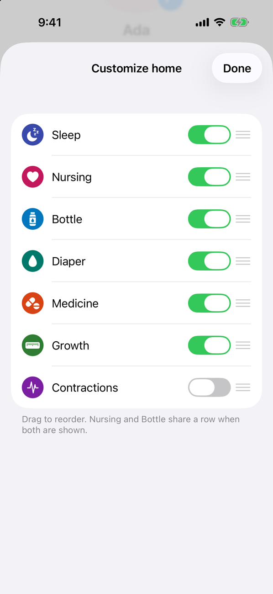
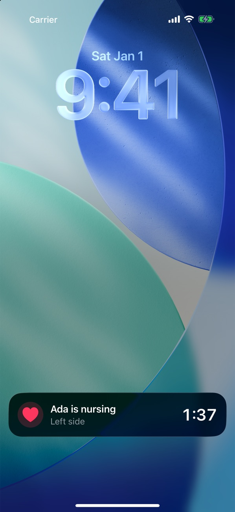
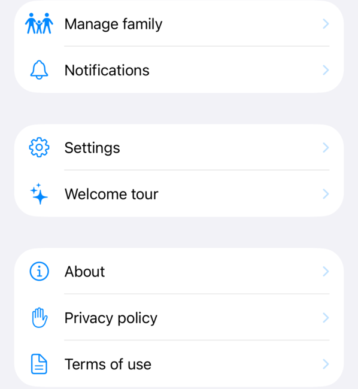
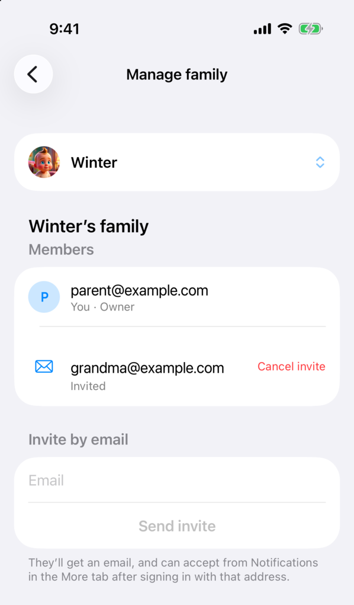
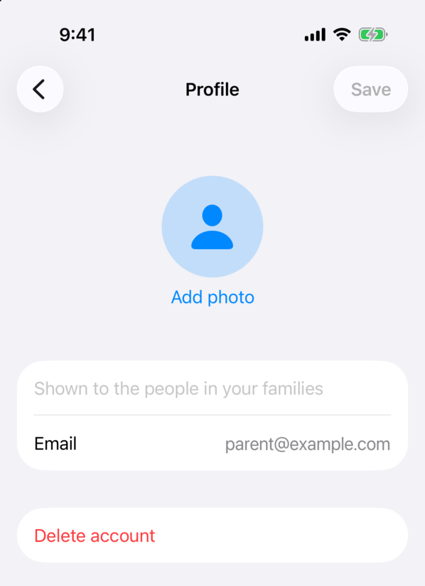

# Frequently Asked Questions

## General

### What is Totly?
Totly is a baby tracker for logging sleep, nursing, bottles, diapers, growth and medicine, and for sharing those logs with your family. It also suggests when your baby's next nap is due, charts growth against the WHO percentiles, and has guides to sleep and to starting solids.

### Which activities can I track?
Sleep, nursing, bottles, diapers, growth (weight, height and head circumference) and medicine doses. Contractions can be tracked too, for before the baby arrives — turn the tile on from **Customize** at the bottom of the Home screen, where you can also reorder or hide tiles. Every entry can have a note.

{ .faq-shot loading=lazy }

### How does the next nap suggestion work?
Totly looks at when your baby last woke up and the wake windows typical for their age, and shows when to put them down next on the Home screen. It's a starting point, not a rule — follow your baby's sleepy cues too.

### Can I see a running timer without opening the app?
Yes. On iPhone, running sleep and nursing timers show on the Lock Screen and in the Dynamic Island as Live Activities. On Android they show as an ongoing notification. Tap either to go back to the timer.

{ .faq-shot loading=lazy }

### Is there a widget or Apple Watch app?
Yes. The **Last Activity** home screen widget, on iOS and Android, shows what was logged last. The Apple Watch app lets you log activities and see recent entries from your wrist.

### Is Totly free to use?
Totly is free to download and use. Premium features may be added in the future, but everything is free today.

### What platforms is Totly available on?
Totly is coming to iOS and Android.

### Do I need an account?
No. You can track your baby on a single device without signing in. Create an account when you want to back up your logs or share them with family.

## Family Sharing

### How do I share my baby with a partner or caregiver?
Sign in, then go to **More** → **Manage family**, pick your baby, start a family and invite members by email. They'll get an email and see the invite under **More** → **Notifications**, where they can accept it.

{ .faq-shot loading=lazy }
{ .faq-shot loading=lazy }

### Do changes show up on everyone's phone?
Yes. While you're signed in, entries sync in real time, so a timer started on one phone shows on the others right away.

### How do I remove someone from my family?
Go to **More** → **Manage family**, pick your baby, and tap **Remove** next to the member. To take back an invite that hasn't been accepted yet, tap **Cancel invite**. To leave a family yourself, tap **Leave family**.

## Account

### How do I delete my account?
Go to **More**, tap your profile at the top, then tap **Delete account** and type your email to confirm. Your babies with their logs and photos, and the families you own with their babies, are deleted for everyone, and you leave any other families. This can't be undone.

{ .faq-shot loading=lazy }

If you can't sign in anymore, email **support@plusmobileapps.com** from the address you signed up with and we'll delete it for you.

### What happens to my data when I sign out?
Signing out uploads any pending changes, then deletes the babies and logs stored on that device. Sign back in to download them again.

## Support

### How do I report a bug?
Please contact us at **support@plusmobileapps.com** with a description of the issue and your device information.
