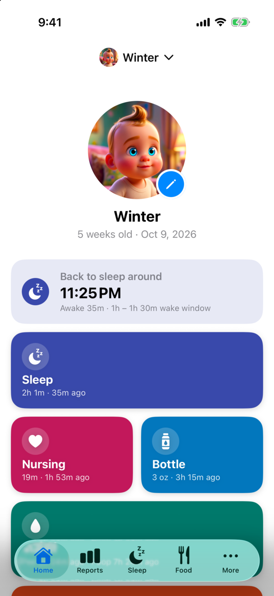
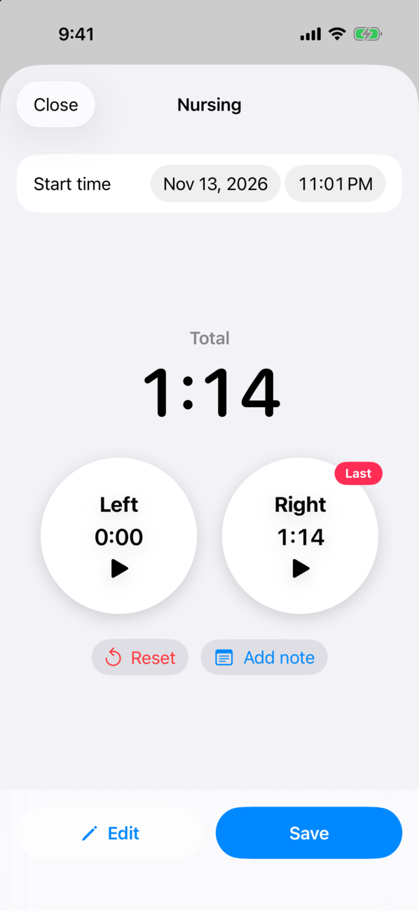
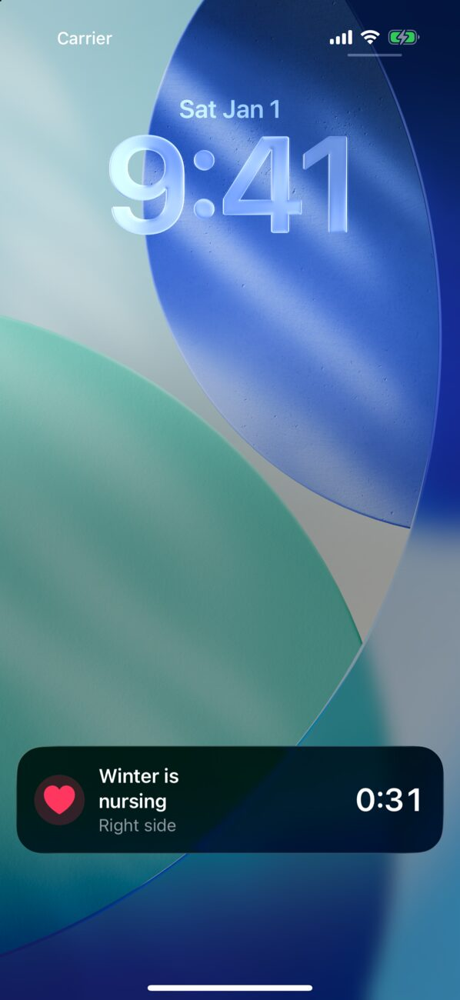
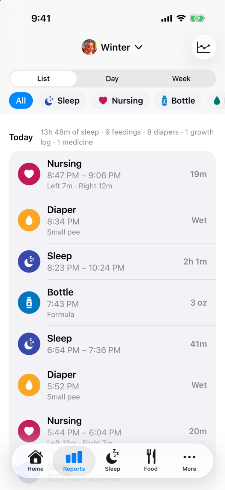
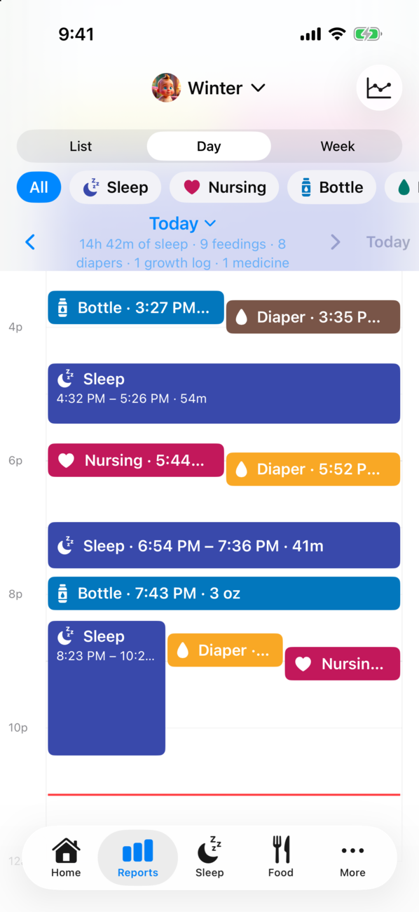
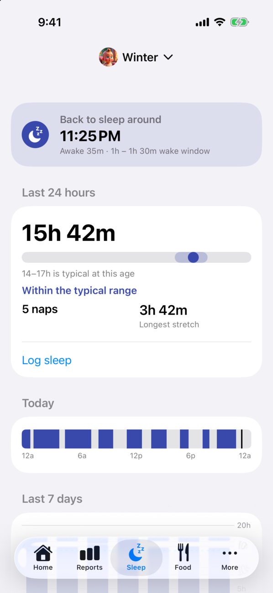
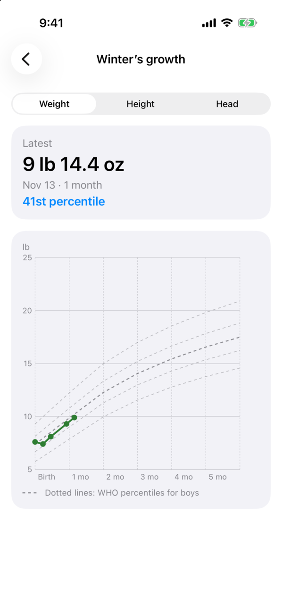
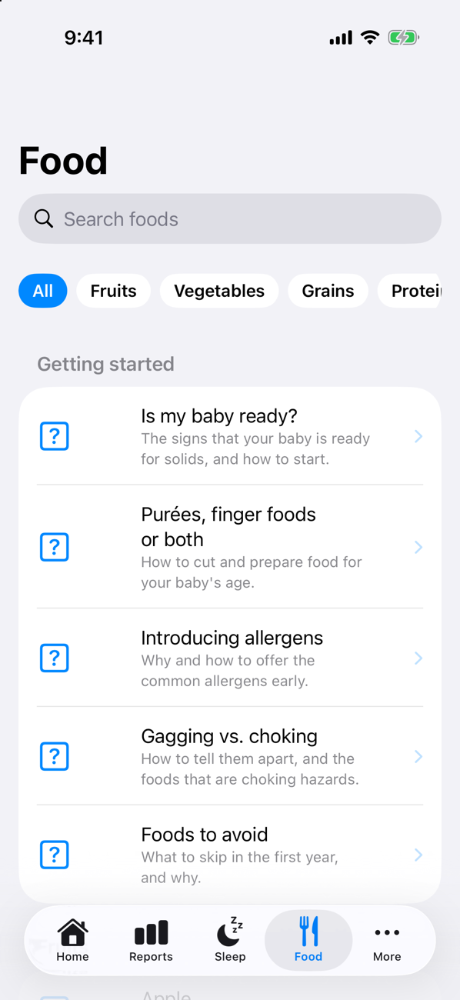

---
hide:
  - navigation
  - toc
---

# The baby tracker for the whole family

Totly keeps track of your little one's day — sleep, nursing, bottles, diapers, growth and medicine — and
shares it with everyone who helps care for them. Log anything in a couple of taps, see the day at a
glance, and know when the next nap is coming.

[Download Totly](download.md){ .md-button .md-button--primary }
[Read the FAQ](faq.md){ .md-button }

{ .screenshot loading=lazy }

## Log anything in a tap

Home shows a tile for each activity with what you logged last and how long ago, so "when did she last
eat?" is answered before you ask it.

- **Sleep and nursing timers** — start a timer and put your phone down. Nursing has a timer for each
  side and remembers which side you finished on. Forgot to start it? Enter the times by hand instead.
- **Bottles** — breast milk, formula or other, in oz or ml.
- **Diapers** — wet, poop, mixed or dry, with amounts, poop color and consistency, and diaper rash.
- **Growth and medicine** — weight, height and head circumference, and doses of the medicines you
  add.
- **Notes** on any entry, and a **Customize** sheet to reorder, show or hide tiles — including
  contractions, for before the baby arrives.

{ .screenshot loading=lazy }

## Timers you can see from anywhere

Running sleep and nursing timers show on the iPhone Lock Screen and Dynamic Island as Live
Activities, and as ongoing notifications on Android — tap one to jump straight back to the timer.
A **Last Activity** home screen widget and an **Apple Watch app** let you check in or log without
opening the app.

{ .screenshot loading=lazy }

## See the whole day — or the whole week

The **Reports** tab shows every entry as a list with a daily summary, or as a day or week timeline you
can pinch to zoom. Filter by activity to spot patterns in sleep or feedings, swipe an entry away to
delete it (with undo), or tap it to edit.

{ .screenshot loading=lazy }
{ .screenshot loading=lazy }

## Know when the next nap is coming

From when your baby last woke up and the wake windows typical for their age, Totly suggests when to
put them down for their next nap or bedtime, right on the Home screen. The **Sleep** tab adds insights into the last 24 hours against the
typical range, today's sleep at a glance, a 7-day day/night breakdown, and guides for each age and
for topics like safe sleep.

{ .screenshot loading=lazy }

## Growth charts with WHO percentiles

Chart weight, height and head circumference against the WHO Child Growth Standards' 5th–95th
percentiles from birth to 24 months, and see which percentile the latest measurement falls on. Enter
measurements in lb and oz or kg, and inches or cm.

{ .screenshot loading=lazy }

## A guide to starting solids

The **Food** tab walks you through starting solids — the signs your baby is ready, purées and finger
foods, introducing allergens, gagging vs. choking, and foods to avoid. Search the food library to see
when each food can be offered, its allergens and choking risk, and how to serve it at every age.

{ .screenshot loading=lazy }

## Share with your family

Invite a partner, grandparent or nanny by email and everyone sees the same babies and logs on their
own phone. Changes sync in real time, so a timer started on one phone shows up on the other right away.
Totly also works fully offline without an account — sign up only when you want to back up your logs
or share them.

## Contact

Have questions or feedback? Reach out to us at **support@plusmobileapps.com**.
